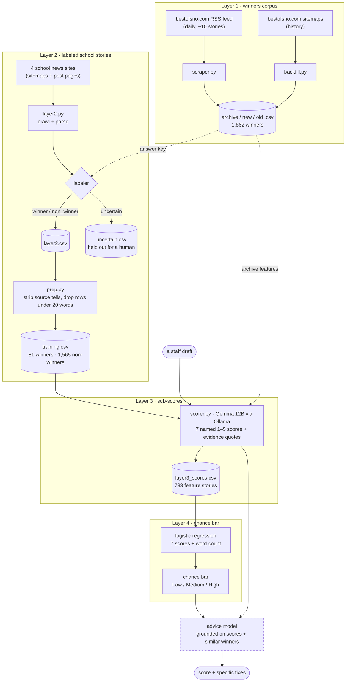
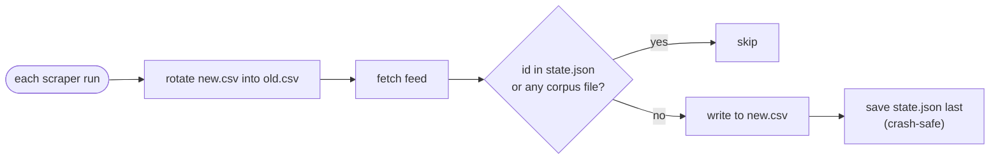
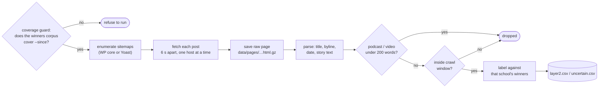
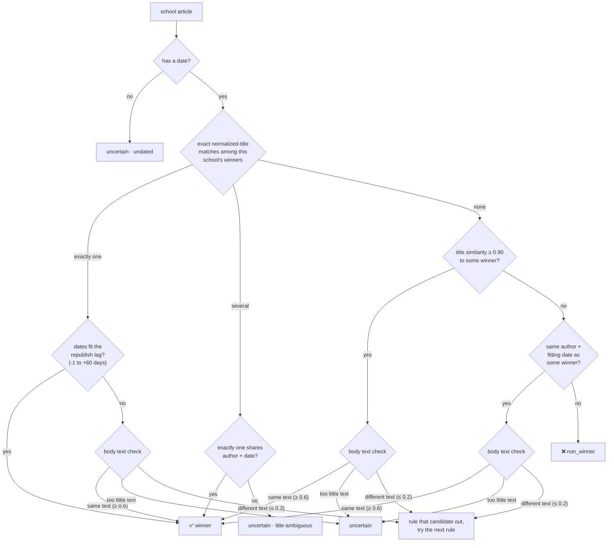
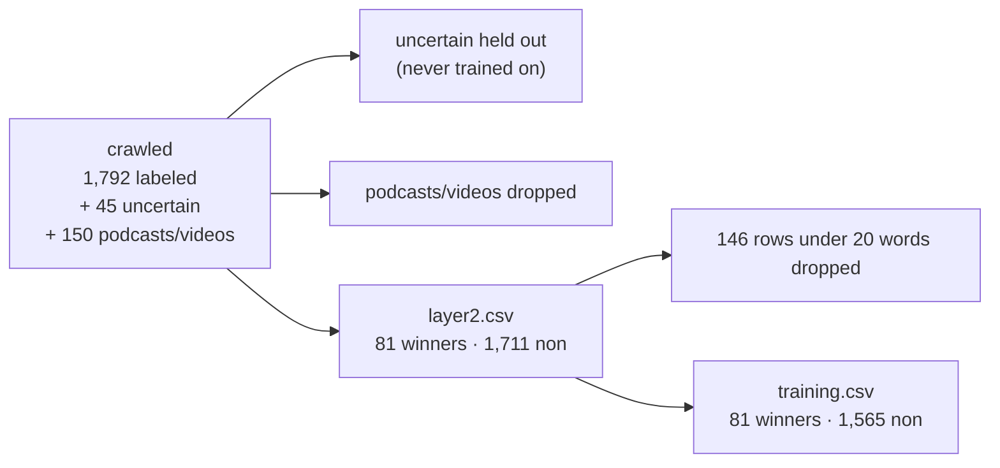
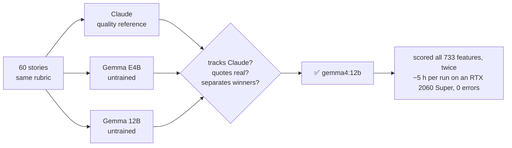

# Best of SNO LLM Advisor

A newsroom tool that reads a student journalist's draft and answers two questions:

1. **How Best-of-SNO-like is this story?** A *chance bar* from 0–100%, built from named
   sub-scores (lede, sourcing, quotes, focus, …) so the number explains itself.
2. **What would make it better?** Advice tied to *this* draft's weakest sub-scores,
   not generic writing tips.

[Best of SNO](https://bestofsno.com) is a daily showcase of the strongest student
journalism on the SNO Sites network, the shared WordPress platform behind thousands
of high-school newspapers. Being picked is a mark of quality. This project learns
what picked stories have in common by comparing them with stories from the same
schools that weren't picked.

> [!NOTE]
> **Status:** Layers 1–2 (data) and Layer 3 (the scorer) are built. Gemma 12B has
> scored all 733 in-depth feature stories twice with the reworded Focus, and the two
> runs are averaged. Layer 4 (the chance bar) is merged and refitted, and
> the advice model comes next. See [Roadmap](#roadmap).


---

## Contents

- [How it works](#how-it-works)
- [The data so far](#the-data-so-far)
- [Layer 1: the winners corpus](#layer-1-the-winners-corpus)
- [Layer 2: school-site crawl and auto-labeling](#layer-2-school-site-crawl-and-auto-labeling)
- [Training-data prep](#training-data-prep)
- [Layer 3 and 4: scoring and the chance bar](#layer-3-and-4-scoring-and-the-chance-bar)
- [Getting started](#getting-started)
- [Command reference](#command-reference)
- [Data files](#data-files)
- [Repository layout](#repository-layout)
- [Crawling politely](#crawling-politely)
- [Lessons from live data](#lessons-from-live-data)
- [Roadmap](#roadmap)
- [Further reading](#further-reading)

---

## How it works

The project is four layers. Each one produces what the next needs.



Dashed boxes aren't on `main` yet.

**Why this shape?** A language model asked "what are this story's chances?" will
confidently make up a number. Here the number comes from a small statistical model
(about seven weights) fitted on real winners and non-winners. The language model's
job is narrower: read the story and grade it on a fixed rubric. Because the chance
bar is built from named grades, it doubles as the diagnosis: *"lede 2/5 is what's
dragging you down."*

---

## The data so far

Every chart below is drawn from the local data by
[`docs/images/make_charts.py`](docs/images/make_charts.py) and contains counts
only. Re-run it after a new crawl to refresh them.

### Winners vs. non-winners, by school


Winners are rare: about **1 in 20** stories overall, and most come from one school.
Layer 4 will need class weighting and probability calibration so the rare class
isn't drowned out.

### Winners run about twice as long


| | Winners (81) | Non-winners (1,565) |
|---|---|---|
| Words, 10th percentile | 810 | 283 |
| Words, median | 1,331 | 702 |
| Words, 90th percentile | 2,514 | 1,233 |

This is the main trap for the scorer. A rubric could separate winners from
non-winners just by noticing that one group is long features and the other is
short sports briefs. So **length is never one of the grades**. The rubric asks
whether length is *earned* (Focus: nothing could be cut without loss; Depth:
reporting beyond interviews), and word count goes into Layer 4 as a separate input
so its weight is measured, not assumed.

### Winners are mostly features


For this reason the first chance bar covers **in-depth features only** (winning
features vs. non-winning features, plus 624 feature winners from the archive).
Every story type still gets sub-scores and advice. Other types show "chance bar
not available for this story type yet" instead of an invented number.

### The winners corpus


---

## Layer 1: the winners corpus

The answer key. Every story Best of SNO has picked since 2025-12-01, with full text
and metadata.

| Part | Module | What it does |
|---|---|---|
| 1a · daily | [`scraper.py`](best_of_sno/scraper.py) | Reads `bestofsno.com/feed/` (about 10 recent stories with full text), rotates the previous `new.csv` into `old.csv`, writes newly seen stories to `new.csv`. |
| 1b · history | [`backfill.py`](best_of_sno/backfill.py) | Walks `wp-sitemap.xml` → post sitemaps, fetches each post page, parses the `By Author, School • Date` byline into `archive.csv`. Resumable. |

All three corpus files share one 12-column schema, and **each winner lives in
exactly one file**. Ids match the feed's guid (`https://bestofsno.com/?p=<n>`), so
the daily scraper and the backfill never double-count.



> [!IMPORTANT]
> **Best of SNO's `published` date is the *republish* date**, typically 3–40 days
> (median 18) after the story first ran on its school's site. Dates are never
> compared for equality anywhere in this project. They're checked against a lag
> window instead.

---

## Layer 2: school-site crawl and auto-labeling

A model can't learn "what wins" from winners alone. It needs the **negative class**:
real student journalism from the same schools, in the same months, that *wasn't*
picked. Layer 2 crawls four SNO school sites and labels every article by
cross-checking it against the winners corpus.

| Host | School |
|---|---|
| scotscoop.com | Carlmont High School |
| torreypinesfalconer.com | Torrey Pines High School |
| theburlingameb.org | Burlingame High School |
| harkeraquila.com | The Harker School |

A fifth site, El Estoque (Monta Vista), was dropped after it began answering the
crawler with HTTP 403. The policy is to never work around a block.

### The pipeline



The crawl window is **2025-12-01 → 2026-09-15**. It starts early enough to catch
December stories that won in January, and ends 40+ days before the crawl so every
article has had time to be picked. Winners and non-winners come from the same
window, so a model can't learn *when* a story ran instead of *how good* it is.

### The labeler

Mislabeling a real winner as a non-winner would teach the model that a winning
story is a losing one. That's the worst data failure this project can have, so
the labeler sends anything it isn't sure about to `uncertain.csv` for a human
rather than guessing.



**Body text check:** both stories are split into overlapping 5-word phrases
("shingles"). If at least 60% of the winner's phrases appear in the school article,
it's the same story. If 20% or fewer do, it's a different one. Stories with fewer
than 50 phrases are too short to judge.

This check cut the uncertain pile from **277 rows to 46**. Of those, 45 are undated
pages (crosswords, issue PDFs, a homepage). The last one, a 28-word satire teaser
matched only on author and date, was labeled non-winner by hand (`HAND_LABELS` in
`layer2.py`, which `--relabel` and `--reparse` apply before any rule).

### The leakage rule

> [!WARNING]
> Every Layer 2 row, **winners included**, carries the *school-site* text, never
> the bestofsno.com copy. If winners came from one website and non-winners from
> another, a model could learn to spot the website's formatting instead of good
> writing.

To make that work, the school-site parser was tuned until its output matches Best
of SNO's copy of the same story. The median 5-word-phrase overlap is **0.995**
across the 70 winners that have full Best of SNO text. Fixes along the way:
repairing stray closing tags that cut stories short, dropping photo galleries and
featured-image captions, and reading long-form "split" stories segment by segment.

---

## Training-data prep

[`prep.py`](best_of_sno/prep.py) turns `layer2.csv` into `training.csv`, offline. It
removes the remaining **source tells**: small artifacts that would let a model
guess the label without reading the story.

| Removed | Why |
|---|---|
| "Story continues below advertisement" | An ad marker that appears on school sites only. |
| Leading `Name · ` photo credit on Carlmont long-form stories | Found on 13 of 81 winners but only 14 of 1,710 non-winners, so it gives the label away. |
| Escaped HTML tags | Parsing debris. |
| Rows under 20 words | Crosswords, trivia, sudoku, galleries, issue PDFs (146 rows). Photo essays (20–80 words) stay. |



`training.csv` is also written through the formula-injection-guarded CSV writer.
That writer neutralizes cells starting with `=`, `+`, `-` or `@` so a spreadsheet
can't execute them.

---

## Layer 3 and 4: scoring and the chance bar

*Design and full results: [`docs/superpowers/specs/2026-11-01-layer3-subscore-rubric-design.md`](docs/superpowers/specs/2026-11-01-layer3-subscore-rubric-design.md).*

### The sub-scores

[`scorer.py`](best_of_sno/scorer.py) gives each story seven 1–5 grades, each with a
short evidence quote from the story, and tags its story type in the same call. A
grade is a rubric score for one quality, not a probability. Layer 4 learns from
data how much each quality matters for winning.

| # | Dimension | A 5 looks like |
|---|---|---|
| 1 | **Lede** | A specific detail or scene you'd remember that leads straight into why the story matters. |
| 2 | **Sourcing** | People with a direct stake; a range of viewpoints; named over anonymous. |
| 3 | **Quotes** | Reveal feeling or insight the writer couldn't paraphrase, not logistics. |
| 4 | **Focus** | A sharp point stated early; every section moves it forward, and nothing could be cut without loss. |
| 5 | **Reporting depth** | Facts, data, documents and scenes beyond interviews. |
| 6 | **Significance** | Clear reason to care; stakes beyond the school. |
| 7 | **Craft** | Clear sentences, flow between sections, a real ending. |

Each level of each dimension has a written anchor (full text in `DIMENSIONS` in
`scorer.py`). Length itself is not a grade. Word count goes into Layer 4 as its own
input, so the data decides how much it adds on top of the seven grades.

### Choosing the scorer

Three scorers graded the same 60 stories (30 winning features, 30 non-winning
features matched on length and school) with the same rubric:



| | Claude | Gemma 12B | Gemma E4B |
|---|---|---|---|
| AUC, total score (0.5 = coin flip) | 0.67 | 0.62 | 0.65 |
| Evidence quotes actually in the story | 100% | 80% | 50% |
| Rank agreement with Claude | – | 0.67 | 0.49 |
| Median seconds per story | – | 29.5 | 5.5 |

Gemma 12B won: it tracks Claude far better than the small model and makes up fewer
evidence quotes. Claude can't be the live scorer because training stories and real
drafts must go through **the same pinned setup**: Ollama, temperature 0, seed 0,
an 8,192-token context, thinking off, JSON-schema output. A reply that doesn't fit
the schema is logged as an error, never as a score.

### What the scores show


- **The total beats word count alone** (0.82 vs 0.77 among school stories; 0.71 vs
  0.62 with archive winners), so the grades carry information beyond length.
- **Significance and depth** pick out school winners best. **Focus**, reworded on
  2026-11-03 to ask for a point stated early and sections that move it forward, went
  from the weakest score (0.53) to mid-pack (0.72), and its scores now spread over
  2–5 instead of bunching at 4–5.
- Each story is scored twice and the two runs averaged: 519 of 733 stories came back
  identical, and 345 of the 347 changed scores moved by 1 point.
- Archive winners score lower than the four schools' winners, mostly on depth and
  significance, and are shorter.

### The chance bar (Layer 4)

`layer4.py` fits a class-balanced logistic regression on the seven grades plus word
count, in plain Python. `source` is never an input, because every archive row is a
winner. Within one school the model is no better than length alone (held-out AUC
0.59 vs 0.62; only 94 Carlmont stories, so this number moves ±0.1 by chance). So the
bar is shown as **Low / Medium / High** rather than a precise percentage. Held out on
the four schools, Low stories won 5%, Medium 27% and High 53%.

### Advice

Gemma will be QDoRA fine-tuned (on Google Colab) to write advice from a story, its
sub-scores and its chance bar. Training starts by imitating grounded advice
examples, then improves through rounds where Gemma drafts several versions and a
stronger model grades them against a checklist ("specific to this draft?",
"points at the weakest scores?").

---

## Getting started

Requires Python 3.14 (others likely work) and runs on macOS or Linux.

```bash
git clone https://github.com/jasqnlu/Best-of-sno-llm-advisor.git
cd Best-of-sno-llm-advisor
python3 -m venv .venv && source .venv/bin/activate
pip install -r best_of_sno/requirements.txt pytest

python -m pytest best_of_sno/tests -q    # 262 tests, fully offline, ~3 s
```

Dependencies are deliberately small: `requests`, `feedparser`, `beautifulsoup4`,
`defusedxml`. CSVs are handled with the standard library, not pandas.

Scoring (Layer 3) also needs [Ollama](https://ollama.com) running locally with the
scorer model: `ollama pull gemma4:12b`. It runs on an 8 GB GPU but takes about 30
seconds per story.

### Building the data from scratch

```bash
# 1. Winners: history first, then the daily feed
python -m best_of_sno.backfill --since 2025-12-01      # hours: 6 s per post
python -m best_of_sno.scraper

# 2. School-site stories, auto-labeled (about 3.5 hours for 4 sites)
python -m best_of_sno.layer2
tail -f best_of_sno/logs/layer2.log

# 3. Clean training set (and the winners' source_site column)
python -m best_of_sno.prep
python -m best_of_sno.sources                         # also writes school_sites.csv

# 4. Score every in-depth feature (hours; needs Ollama), then export
python -m best_of_sno.layer3 score gemma4:12b
python -m best_of_sno.layer3 score gemma4:12b --run 2  # second run; export averages the two
python -m best_of_sno.layer3 export gemma4:12b
python -m best_of_sno.layer3 consistency gemma4:12b   # re-score 30; repeats should match

# 5. Fit and check the chance bar (seconds, offline)
python -m best_of_sno.layer4 evaluate
python -m best_of_sno.layer4 fit

# 6. Refresh the README charts
python docs/images/make_charts.py
```

Every long job is **resumable**. Interrupt it and run the same command again to
pick up where it stopped.

---

## Command reference

| Command | Flags |
|---|---|
| `python -m best_of_sno.scraper` | `--dry-run` · `--no-rotate` · `--data-dir` · `--feed-url` |
| `python -m best_of_sno.backfill` | `--since YYYY-MM-DD` · `--limit N` · `--delay 6` · `--dry-run` · `--data-dir` |
| `python -m best_of_sno.layer2` | `--sites a.com,b.org` · `--since` / `--until` · `--limit N` · `--delay 6` · `--dry-run` · `--data-dir` |
| `python -m best_of_sno.layer2 --relabel` | Re-judge `uncertain.csv` with the current rules, offline |
| `python -m best_of_sno.layer2 --reparse` | Rebuild rows from saved raw pages with the current parser, offline |
| `python -m best_of_sno.layer2 --refetch-thin` | Re-download rows under 200 words |
| `python -m best_of_sno.prep` | `--data-dir` |
| `python -m best_of_sno.sources` | Clean the winners' `source_site` from school names; write `school_sites.csv` · `--dry-run` |
| `python -m best_of_sno.layer3 score MODEL` | Score every in-depth feature with the pinned scorer (resumable) · `--run N` fills a further run |
| `python -m best_of_sno.layer3 export MODEL` | Write `layer3_scores.csv`, averaging every run a story has |
| `python -m best_of_sno.layer3 consistency MODEL` | Re-score 30 scored stories (fixed sample) and report any that changed; the main scores file is untouched |
| `python -m best_of_sno.layer4 evaluate` · `fit` | Cross-validated report (incl. within-school AUC) · save the fitted model |
| `python -m best_of_sno.layer3_trial select` · `run MODEL` · `compare` | The 60-story scorer trial · `run MODEL --variant focus-v2` tries a rubric rewording |
| `python -m best_of_sno.layer3_trial handscore-page` · `import-owner FILE` | Optional hand-scoring page and import |

`--reparse` exists because parser fixes used to mean a 3.5-hour re-download. Raw
pages are now kept gzipped, so the next fix is a quick offline rebuild.

---

## Data files

Everything lives in `best_of_sno/data/` and is **gitignored**. Story text is other
students' copyrighted work: it's stored privately for analysis and never committed
or republished.

| File | Rows | What |
|---|---|---|
| `archive.csv` | 1,862 | Best of SNO winners from the backfill |
| `new.csv` / `old.csv` | ~10 / – | Winners from the daily feed (latest run / earlier runs) |
| `layer2.csv` | 1,792 | Labeled school-site stories (`winner` / `non_winner`) |
| `uncertain.csv` | 45 | Stories the labeler wouldn't call, with the candidate winner beside each |
| `training.csv` | 1,646 | Cleaned training set (81 winners, 1,565 non-winners) |
| `school_sites.csv` | 296 | Each winning school's site and winner count, for picking schools to crawl (no story text) |
| `layer3_scores.csv` | 733 | Seven grades, total, word count, story type and number of runs per feature story (no story text) |
| `layer3_trial/` | – | Scorer-trial picks and each scorer's replies |
| `pages/` | – | Gzipped raw pages for `--reparse` |
| `*state.json` | – | Resume checkpoints |

**Shared columns** (all corpus and Layer 2 files):
`id, url, title, published, categories, author, school, summary, body, word_count, source_site, scraped_at`

- `layer2.csv` and `training.csv` add `label, matched_id`.
- `uncertain.csv` adds `reason, candidate_title, candidate_url`.

---

## Repository layout

```
best_of_sno/
├── scraper.py         Layer 1a · daily RSS scraper
├── backfill.py        Layer 1b · historical sitemap backfill
├── layer2.py          Layer 2  · school-site crawl, parser, labeler, --relabel/--reparse
├── prep.py            training.csv builder (source-tell removal)
├── sources.py         winners' source_site cleanup + school_sites.csv
├── scorer.py          Layer 3  · the rubric and the pinned Ollama scorer
├── layer3.py          Layer 3  · score all features, export layer3_scores.csv
├── layer3_trial.py    Layer 3  · 60-story three-way scorer trial, rubric variants
├── layer4.py          Layer 4  · the chance bar (logistic regression)
├── requirements.txt
├── data/              (gitignored) CSVs, scores, state, raw pages
├── logs/              (gitignored) one log per job
└── tests/             26 test files, 262 tests, offline
    └── fixtures/      saved real pages, sitemaps and feeds from each site
docs/
├── images/            README charts + the script that draws them
├── project-context.md         full project briefing
├── session-handoff.md         state as of 2026-11-01
└── superpowers/
    ├── specs/         one design doc per layer
    └── plans/         one step-by-step TDD plan per feature
```

### How features get built

Every feature follows the same path: **design spec → implementation plan →
test-first build → whole-branch review → pull request**. The tests run against
saved copies of real pages from each site, so a site's quirks (Yoast sitemaps, date
permalinks, stray closing tags, long-form segments) are each pinned by a test.

---

## Crawling politely

| Rule | How |
|---|---|
| Respect `Crawl-delay` | 6 seconds between *every* request to a host, sitemaps included |
| One host at a time | Sites are crawled in sequence, never in parallel |
| Identify the crawler | A research User-Agent with a contact email |
| No query URLs | Anything containing `?` is skipped |
| Never work around a block | A site that returns 403 is dropped, not retried with tricks |
| Safe XML | Sitemaps are parsed with `defusedxml` |

---

## Lessons from live data

The original designs made assumptions that the real sites disproved. Each became a
test and a fix:

1. **The sites aren't uniform.** Slug, date or numeric permalinks; WordPress core or
   Yoast sitemaps; dates in the byline or elsewhere; titles with or without a
   "– Site Name" suffix.
2. **Best of SNO republishes 3–40 days later** under a new date, so exact-date
   matching never fired. It became a lag window.
3. **A lone exact title match isn't proof.** Recurring columns reuse titles, so
   dates (or body text) must agree too.
4. **The "Best of SNO" badge isn't in school-site HTML.** Cross-checking against the
   winners corpus is the only way to label.
5. **The crawl window can't start before the winners corpus,** or early winners get
   silently labeled non-winners. That's what the coverage guard prevents.
6. **Layout differences are a leak.** School pages had to be parsed until their text
   matched Best of SNO's copy (0.995 median overlap).
7. **Keep raw pages.** Three parser fixes in one day each cost a full re-download
   before `--reparse` existed.

---

## Roadmap

| Stage | Status |
|---|---|
| Layer 1a · daily scraper | ✅ built · run by hand (or re-run the backfill, which catches up) |
| Layer 1b · historical backfill | ✅ built · corpus covers 2025-12-01 → 2026-10-30 |
| Layer 2 · crawl + labeler | ✅ built, crawled, cleaned |
| Training-data prep | ✅ built · `training.csv` ready |
| Layer 3 · sub-score rubric + scorer | ✅ built · Gemma 12B scored 733 features |
| Layer 4 · chance bar | ✅ built (PR #14): logistic regression, Low / Medium / High |
| Advice model | ⬜ design approved, not built: QDoRA-fine-tuned Gemma 12B ([design](docs/superpowers/specs/2026-11-03-advice-model-design.md)) |

Also on the list:
- find out why Layer 4 gains little from the scores within one school: the
  regression learns mostly from archive winners (518 of 578), so its weights may
  suit "archive vs school" better than "winner vs non-winner at one school"
  ([details](docs/superpowers/specs/2026-11-01-layer3-subscore-rubric-design.md#re-score-with-focus-v2-two-runs-averaged-run-2026-11-04-on-the-pc));
- pick more schools to crawl from `school_sites.csv`.

Done: all 733 features re-scored with the reworded Focus, two runs each, averaged,
and Layer 4 refitted (2026-11-04); the editor's own publication (theburlingameb.org) is one of the four crawled
sites; the last `author-date` uncertain row was settled by hand; the winners'
`source_site` was cleaned (`python -m best_of_sno.sources`: blanks 1,153 → 648,
Flourish chart embeds no longer count as a school).

---

## Further reading

- [`docs/project-context.md`](docs/project-context.md): the full briefing (goals, non-goals, architecture, Layers 1–2 in depth)
- [`docs/session-handoff.md`](docs/session-handoff.md): what changed after the first crawl and the current numbers
- [`docs/superpowers/specs/2026-11-01-layer3-subscore-rubric-design.md`](docs/superpowers/specs/2026-11-01-layer3-subscore-rubric-design.md): Layer 3 rubric, scorer trial and full scoring results
- [`docs/superpowers/specs/`](docs/superpowers/specs/): design docs, including the Layer 2 amendments from live runs
